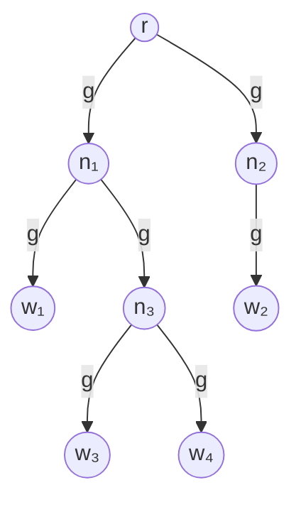
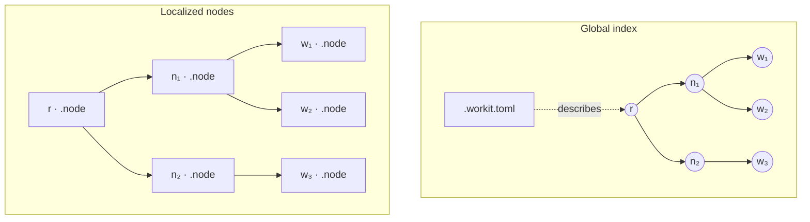
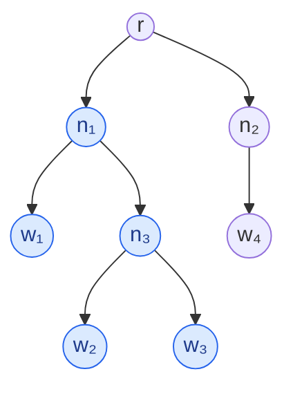
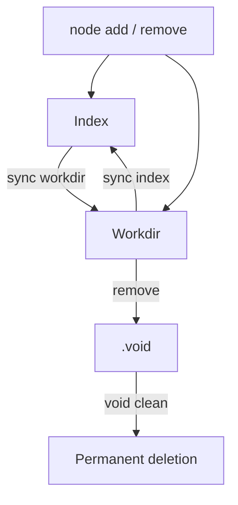
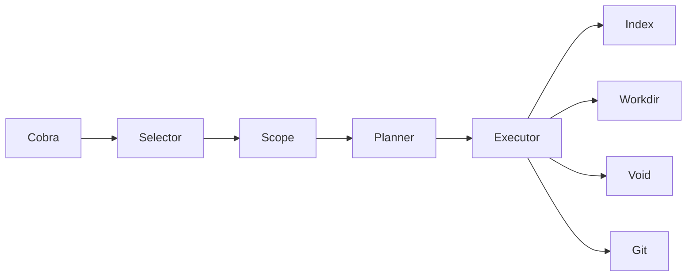
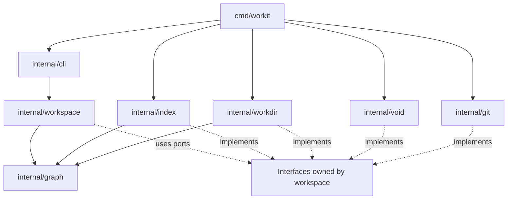

# Workit — Architecture

> Centralized knowledge. Localized behavior. Generalized execution.

## 1. Graph

$$G=(V,E)$$

$$K_V=\{r,n,w\},\qquad \kappa:V\to K_V$$

| Kind | Meaning | Family |
|---|---|---|
| $r$ | Root | Composite |
| $n$ | Namespace | Composite |
| $w$ | Workstation (Git repository) | Leaf |

$$V=C\sqcup L$$
$$C=\{v\in V\mid\kappa(v)\in\{r,n\}\}$$
$$L=\{v\in V\mid\kappa(v)=w\}$$

Edge kind: $K_E=\{g\}$, where $g$ denotes grouping.

$$E\subseteq C\times(V\setminus\{r\})$$

$$\deg^-(r)=0,\quad \deg^-(v)=1\ (v\ne r),\quad \deg^+(w)=0\ (w\in L)$$

Every node is reachable from the unique root. Only composites carry outgoing grouping edges.



## 2. Global vs. localized metadata



$$M_{global}(G)=m_r,\qquad M_{local}(G)=\{m_v\mid v\in V\}$$

| Property | Global | Localized |
|---|---|---|
| Metadata files | 1 | $\lvert V\rvert$ |
| Knowledge | Centralized | Distributed |
| Node autonomy | Lower | Higher |
| Consistency | Simpler | More complex |
| Portability | Entire workspace | Individual nodes |
| Reconstruction | Read index | Traverse nodes |
| Filesystem pollution | Minimal | Distributed |

**Decision:** Global index with localized execution. Logical nodes do not require individual `.node` files.

```text
workspace/
├── .workit.toml
├── .void/
├── personal/
│   └── portfolio/
├── tools/
│   ├── typy/
│   └── devky/
└── essays/
    └── dimensional-invariance/
```

## 3. Localization and scope

$$\rho(pwd)=\text{nearest ancestor containing .workit.toml}$$
$$\sigma_I(pwd)=s$$

Select the deepest registered ancestor of `pwd`, using path components. For sync only, an unregistered directory inside a known composite may contribute discovered nodes to that composite's scope; it does not become a registered node implicitly.

$$S(s)=\{s\}\cup\{v\in V\mid s\leadsto v\}$$

$$S(r)=V,\qquad S(w)=\{w\}$$



### Foresting

$$T_f(s)=\{v\in S(s)\mid A(f,v)\}$$

$A(f,v)$ is the applicability predicate of function $f$ at node $v$.

For Git operations:

$$T_{repo}(s)=S(s)\cap L$$

$$\mathcal F_f(s)=\big\{(v,f(v))\mid v\in T_f(s)\big\}$$

| Selection | Scope | Git targets |
|---|---|---|
| Root | Entire tree | All repositories |
| Namespace | Subtree | Descendant repositories |
| Repository | One node | Itself |

Localized selection; generalized functions. Choose plan-first foresting over executing a recursive wave: calculate, validate, then execute. Parallelism is optional.

## 4. State layers

$$\mathcal W=(I,D,Q)$$

| Symbol | Layer | Meaning |
|---|---|---|
| $I$ | Index | Registered graph |
| $D$ | Workdir | Discovered physical graph |
| $Q$ | Void | Quarantined physical content |



Node identity uses the workspace-relative path and kind, plus repository owner/name for repository nodes. Same-path incompatible nodes are conflicts, not additions or removals. Discover only eligible directories; stop at Git repository boundaries and exclude `.void` and Workit metadata. Do not prune on incomplete discovery.

## 5. Reconciliation

Let $I_s,D_s$ be the scoped index and workdir node sets (including discoverable unregistered descendants of the selected composite).

$$\Delta_I=I_s\setminus D_s,\qquad \Delta_D=D_s\setminus I_s$$

| Command | Transformation (conflict-free scope) |
|---|---|
| `sync index add` | $I_s'=I_s\cup\Delta_D$ |
| `sync index prune` | $I_s'=I_s\setminus\Delta_I$ |
| `sync workdir add` | $D_s'=D_s\cup\Delta_I$ |
| `sync workdir remove` | $D_s'=D_s\setminus\Delta_D$ |

$$\operatorname{syncIndex}:(I,D,Q)\to(I',D,Q)$$
$$\operatorname{syncWorkdir}:(I,D,Q)\to(I,D',Q')$$

Workdir add creates namespaces and clones missing repositories; remove quarantines extras. Index add registers discovered namespaces and identifiable GitHub repositories. Index prune unregisters missing nodes only. Root is protected; preserve ancestor closure, create parents before children and never remove a matched descendant. These set equations describe successful operations; conflicts and failures are reported separately.

## 6. Node and Void

$$\operatorname{nodeAdd}:(I,D,Q)\to(I',D',Q)$$
$$\operatorname{nodeRemove}:(I,D,Q)\to(I',D',Q')$$

| Operation | Index | Workdir | Void |
|---|---|---|---|
| node add | Register | mkdir / clone | — |
| node remove | Unregister | Move out | Receive |
| sync index add/prune | Modify | Read | — |
| sync workdir add/remove | Read | Modify | Receive on remove |
| void clean | — | — | Delete |

```text
workit node add tools
workit node add cohesian-tools/typy.git
```

$$\kappa(a)=\begin{cases}n & \text{if }a=\text{name}\\w & \text{if }a=\text{owner/repository.git}\end{cases}$$

Add is relative to the selected composite; repository name is the local directory name. Reject ambiguous or invalid names and collisions. Removal of a composite includes its subtree and requires explicit confirmation. Move the physical payload into root `.void/`, preserving contents, Git metadata and original path; use unique quarantine entries. Permanent deletion only through `void clean`, with confirmation.

## 7. Complete CLI structure

```text
workit
├── init
├── config
│   └── protocol <https|ssh>
├── node
│   ├── add <name|owner/repository.git>
│   └── remove <name>
├── sync
│   ├── index
│   │   ├── add
│   │   └── prune
│   └── workdir
│       ├── add
│       └── remove
├── repo
│   ├── status
│   ├── fetch
│   ├── pull <local_branch> <remote_branch>
│   └── push
└── void
    └── clean
```

| Command family | Root | Namespace | Repository |
|---|---|---|---|
| init | Outside workspace only | — | — |
| config | ✓ | ✓ (root config) | ✓ (root config) |
| node | ✓ | ✓ | — |
| sync | ✓ | ✓ | — |
| repo | Forest | Forest | Local |
| void | ✓ | — | — |

`init` establishes the root/index. Git commands delegate to `git`; GitHub authentication is external (`gh auth login`, with HTTPS credential or SSH key setup as applicable).

| Repo command | Behavior |
|---|---|
| status | Ahead, behind, staged, unstaged, untracked; relative to known upstream |
| fetch | Fetch each target; no merge |
| pull | Validate local and remote branches; fast-forward only initially |
| push | Push configured upstream; no force |

Store owner/repository identity independently of clone protocol; protocol changes do not rewrite existing remotes.

## 8. Execution

$$pwd\xrightarrow{\sigma}s\xrightarrow{S}S(s)\xrightarrow{T_f}T_f(s)\xrightarrow{plan}P\xrightarrow{execute}R$$



Validate before mutations. Serialize index writes; preserve valid graph invariants and report partial failures per node. A failed clone or quarantine must not silently register or unregister a node. Cross-layer operations are recoverable, not inherently atomic.

## 9. Proposed Go scaffolding

```text
workit/
├── go.mod
├── go.sum
├── README.md
├── docs/
│   └── architecture.md
├── cmd/
│   └── workit/
│       └── main.go
└── internal/
    ├── cli/
    │   ├── root.go
    │   ├── init.go
    │   ├── config.go
    │   ├── node.go
    │   ├── sync.go
    │   ├── repo.go
    │   └── void.go
    ├── graph/
    │   ├── graph.go
    │   ├── node.go
    │   ├── edge.go
    │   └── scope.go
    ├── workspace/
    │   ├── workspace.go
    │   ├── selector.go
    │   ├── node.go
    │   ├── sync.go
    │   ├── forest.go
    │   └── plan.go
    ├── index/
    │   ├── index.go
    │   └── toml.go
    ├── workdir/
    │   ├── workdir.go
    │   └── discovery.go
    ├── void/
    │   └── void.go
    └── git/
        └── git.go
```

| Package | Responsibility |
|---|---|
| `cmd/workit` | Composition root and entry point |
| `cli` | Cobra command tree, arguments, flags and output |
| `graph` | Node kinds, edges, invariants and structural scope |
| `workspace` | Localization, node management, reconciliation, foresting and execution plans |
| `index` | Read/write the registered graph and root configuration |
| `workdir` | Discover and materialize physical nodes |
| `void` | Quarantine and permanent cleanup |
| `git` | Delegate to Git and resolve repository transport URLs |



Solid arrows denote conceptual dependencies; dashed arrows denote interface relationships, not necessarily Go imports. `main` constructs and injects the adapters. Keep `graph` independent of Cobra, Git, TOML and filesystem I/O.

$$\text{CLI}\longrightarrow\text{Workspace}\longrightarrow\text{Graph}$$

Cobra mirrors the command tree, not the workspace graph. A command's behavior depends on the selected workspace node at runtime. Prefer explicit command constructors and `RunE` over global state and `init()` registration. Add colocated `*_test.go` files as each package is implemented.

The scaffolding is a proposal, not a generated Go project. Split packages further only when useful; introduce interfaces at actual dependency boundaries.

**Provisional:** config filename, root-only Void, composite-only sync, path identity, fast-forward pulls and plan-first execution. Exact TOML schema, optional `-p`, pull branch switching semantics, scan exclusions and recovery mechanics remain open. No Go implementation yet.
